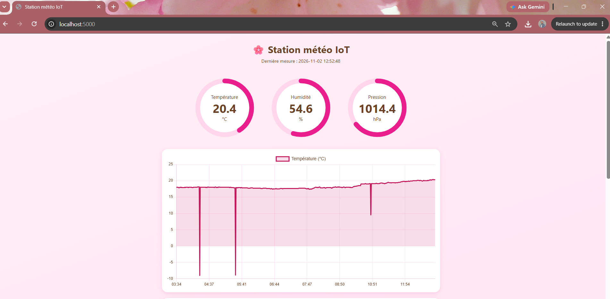
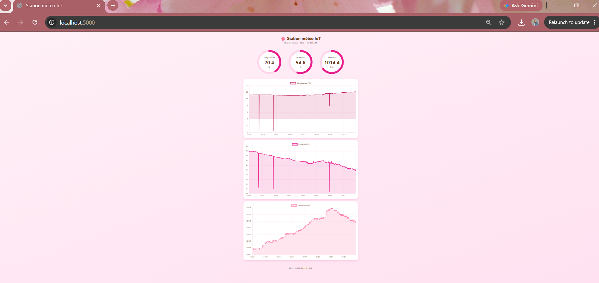
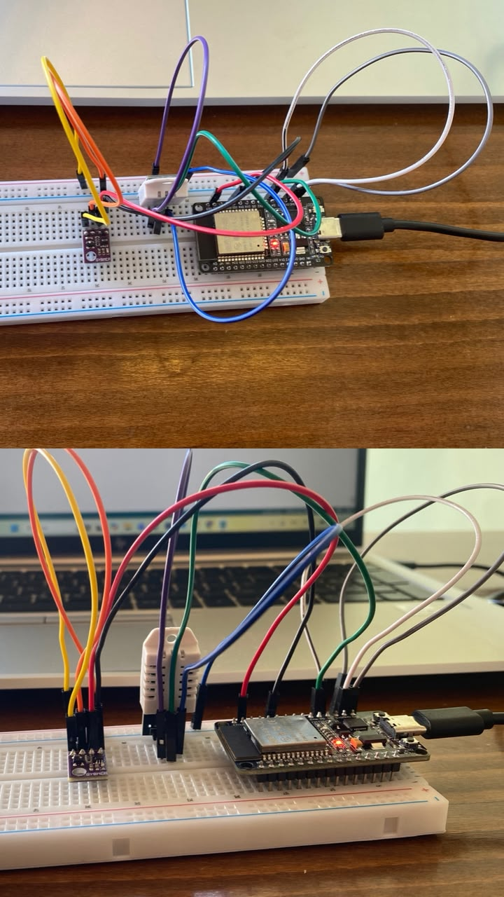
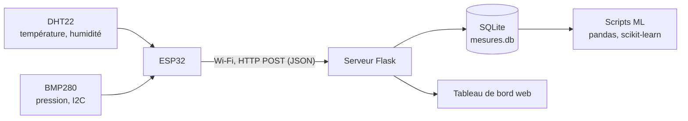
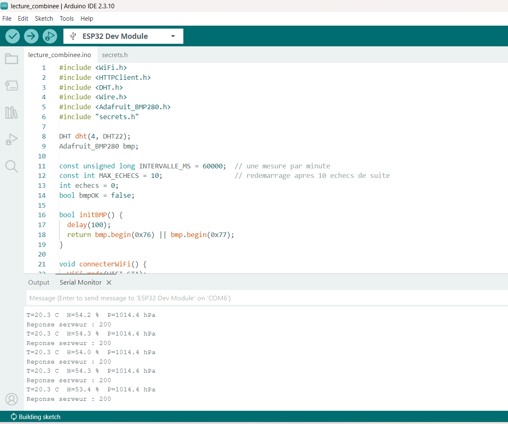
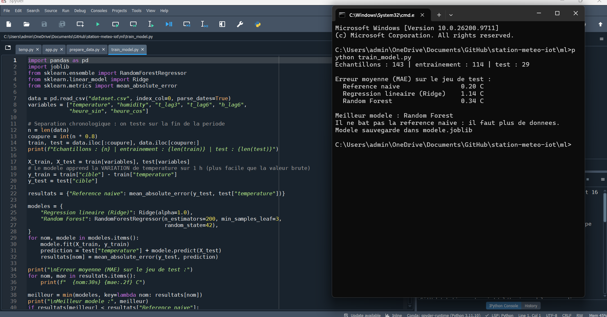

# Station météo IoT connectée avec prédiction par machine learning


## Description

Système de surveillance environnementale basé sur un **ESP32**, un capteur **DHT22** (température, humidité) et un capteur **BMP280** (pression atmosphérique).

L'ESP32 envoie une mesure par minute en Wi-Fi à un **serveur Flask**. Les données sont stockées dans une base **SQLite** et consultables en temps réel sur un **tableau de bord web** (jauges et courbes d'historique). Un pipeline de **machine learning** (pandas, scikit-learn) évalue la possibilité de prédire la température 1 h à l'avance, en comparant des modèles à une référence naïve.

## Aperçu

Tableau de bord : valeurs en temps réel.



Tableau de bord : historique des mesures.



Montage réel sur breadboard.



## Objectifs

- Acquérir en continu la température, l'humidité et la pression
- Transmettre les mesures d'un objet connecté vers un serveur via Wi-Fi
- Stocker l'historique et le rendre accessible par une API REST et une interface web
- Évaluer la faisabilité d'une prédiction de la température à court terme

## Fonctionnalités

**Firmware ESP32 (Arduino C++)**
- Lecture du DHT22 et du BMP280 (bus I2C)
- Envoi d'une mesure par minute en HTTP POST (JSON)
- Reconnexion Wi-Fi automatique
- Validation des mesures avant envoi (valeurs absentes ou hors plage ignorées)
- Réinitialisation du BMP280 en cas de pression aberrante
- Redémarrage automatique après 10 échecs consécutifs

**Serveur (Flask, SQLite)**
- Réception et stockage des mesures horodatées
- API REST pour la dernière mesure et l'historique

**Tableau de bord (HTML, CSS, JavaScript, Chart.js)**
- Jauges circulaires pour la température, l'humidité et la pression
- Courbes d'historique, actualisation automatique toutes les 15 secondes
- Affichage adapté aux écrans de téléphone

**Machine learning (pandas, scikit-learn)**
- Contrôle de la continuité des données collectées
- Nettoyage, regroupement en blocs de 10 minutes, création de variables
- Entraînement et évaluation de deux modèles face à une référence naïve

## Architecture



1. L'ESP32 lit les capteurs, valide les mesures et les envoie au serveur.
2. Le serveur Flask horodate chaque mesure et l'enregistre dans SQLite.
3. Le tableau de bord interroge l'API pour afficher les valeurs et l'historique.
4. Les scripts de machine learning lisent la base pour préparer les données et entraîner les modèles.

## Matériel

| Composant | Rôle |
|---|---|
| ESP32 DevKit (30 broches, puce USB CP2102, USB-C) | Microcontrôleur avec Wi-Fi |
| Capteur DHT22 (module 3 broches) | Température et humidité |
| Capteur BMP280 | Pression atmosphérique (I2C) |
| Breadboard et fils de connexion | Câblage |
| PC Windows | Serveur Flask et entraînement ML |

### Câblage

Les deux capteurs sont alimentés en **3,3 V**.

| Capteur | Broche | ESP32 |
|---|---|---|
| DHT22 | VCC / GND | 3V3 / GND |
| DHT22 | DATA | GPIO 4 |
| BMP280 | VCC / GND | 3V3 / GND |
| BMP280 | SDA | GPIO 21 |
| BMP280 | SCL | GPIO 22 |

Le BMP280 répond à l'adresse I2C `0x76` ou `0x77` selon le module : le firmware essaie les deux.



## Technologies

| Domaine | Outils |
|---|---|
| Matériel | ESP32, DHT22, BMP280 |
| Firmware | Arduino C++, bibliothèques Adafruit (DHT, BMP280) |
| Serveur | Python, Flask |
| Base de données | SQLite |
| Interface web | HTML, CSS, JavaScript, Chart.js |
| Machine learning | pandas, NumPy, scikit-learn, joblib |
| Versionnement | Git, GitHub |

## API REST

| Méthode | Route | Description |
|---|---|---|
| `GET` | `/` | Tableau de bord web |
| `POST` | `/api/data` | Enregistre une mesure envoyée par l'ESP32 |
| `GET` | `/api/latest` | Dernière mesure enregistrée |
| `GET` | `/api/history` | Les 500 dernières mesures |

Exemple de corps envoyé par l'ESP32 :

```json
{ "temperature": 21.5, "humidity": 66.6, "pressure": 1018.9 }
```

## Structure du dépôt

```
station-meteo-iot/
├── firmware/
│   └── lecture_combinee/
│       └── lecture_combinee.ino   Code de l'ESP32
├── server/
│   ├── app.py                     Serveur Flask et API
│   └── templates/
│       └── index.html             Tableau de bord
├── ml/
│   ├── gaps.py                    Contrôle des trous dans la collecte
│   ├── prepare_data.py            Nettoyage et création des variables
│   └── train_model.py             Entraînement et évaluation
├── docs/                          Photos et captures
├── .gitignore
└── README.md
```

## Installation et exécution

### 1. Firmware

1. Installer l'**Arduino IDE** et le support de carte **esp32** (Espressif Systems).
2. Installer les bibliothèques : *DHT sensor library*, *Adafruit Unified Sensor*, *Adafruit BMP280 Library*.
3. Installer le pilote USB **CP210x** si le port COM n'apparaît pas.
4. Dans `firmware/lecture_combinee/`, créer un fichier `secrets.h` (ignoré par Git) :

```cpp
#define WIFI_SSID "VOTRE_WIFI"
#define WIFI_PASSWORD "VOTRE_MOT_DE_PASSE"
#define SERVER_URL "http://IP_DU_PC:5000/api/data"
```

5. Choisir la carte **ESP32 Dev Module**, sélectionner le port, puis téléverser.

L'ESP32 fonctionne uniquement en Wi-Fi **2,4 GHz**, sur le même réseau que le PC.

### 2. Serveur

```bash
pip install flask pandas scikit-learn joblib
cd server
python app.py
```

Ouvrir `http://localhost:5000`. Sous Windows, autoriser Python dans le pare-feu pour les réseaux privés (port 5000) afin que l'ESP32 puisse joindre le serveur.

### 3. Machine learning

```bash
cd ml
python gaps.py            # contrôle des trous dans la collecte
python prepare_data.py    # nettoyage, variables, jeu de données
python train_model.py     # entraînement et évaluation
```

## Fiabilité de la collecte

| Mesure | Rôle |
|---|---|
| Validation des mesures | Une valeur absente ou hors plage n'est jamais envoyée au serveur |
| Réinitialisation du BMP280 | Une pression absurde déclenche une nouvelle initialisation du capteur |
| Redémarrage après échecs répétés | Évite de rester bloqué sur un capteur défaillant |
| Reconnexion Wi-Fi automatique | Reprise après une coupure du réseau |
| Identifiants hors dépôt | `secrets.h` et la base `mesures.db` sont exclus par `.gitignore` |

## Méthodologie de machine learning

**Problème :** prédire la température 1 h plus tard (régression sur série temporelle).

**Préparation des données**

| Étape | Détail |
|---|---|
| Filtrage | Température entre 5 et 45 °C, humidité entre 0 et 100 % |
| Regroupement | Moyenne par blocs de 10 minutes, comblement des trous de 20 minutes au plus |
| Variables | Température et humidité actuelles, température 30 min et 1 h avant, humidité 1 h avant, heure du jour (sinus et cosinus) |
| Cible | Température 1 h plus tard |

**Évaluation**
- Séparation **chronologique** 80 % / 20 % (jamais aléatoire), pour éviter toute fuite d'information du futur vers l'entraînement
- Métrique : erreur absolue moyenne (MAE), en °C
- Référence : méthode de persistance (« dans 1 h, même température qu'actuellement »)
- Les modèles prédisent la **variation** de température sur 1 h, ajoutée à la température actuelle

**Modèles comparés :** régression linéaire régularisée (Ridge) et Random Forest (200 arbres).

## Résultats

Premier prototype : 143 échantillons (114 pour l'entraînement, 29 pour le test).

| Méthode | MAE à +1 h |
|---|---|
| Référence naïve (persistance) | **0,20 °C** |
| Random Forest | 0,34 °C |
| Régression linéaire (Ridge) | 1,14 °C |



**Interprétation.** Sur ce jeu de test court (environ 5 h) et stable, la référence naïve reste meilleure que les deux modèles. L'explication la plus plausible est que la température varie peu sur cette période, et que le bruit du DHT22 (de l'ordre de 0,1 à 0,2 °C) est proche de l'erreur de la référence. Ces résultats constituent un **prototype** : ils reposent sur un seul cycle jour/nuit et ne permettent pas de conclure sur la performance des modèles en général.

## Difficultés rencontrées

| Problème | Cause identifiée ou probable | Solution |
|---|---|---|
| Port COM absent | Pilote USB de la puce CP2102 manquant | Installation du pilote CP210x |
| L'ESP32 ne joignait pas le serveur | Pare-feu Windows bloquant le port 5000 | Autorisation de Python sur les réseaux privés |
| Collecte interrompue pendant 9 h 24 | Interruption côté PC ou alimentation de l'ESP32, détectée grâce au script `gaps.py` | Désactivation de la mise en veille du PC, vérification de la continuité par `gaps.py` |
| Pressions aberrantes (31,7 et 825,9 hPa) | Initialisation défectueuse du BMP280, probablement liée à un contact intermittent | Validation et réinitialisation du capteur dans le firmware, pression exclue du modèle en attendant la fiabilisation du capteur |

## Limites connues

- Un seul cycle jour/nuit et 29 échantillons de test : résultats ML indicatifs
- Serveur de développement Flask, sans authentification : prévu pour un usage sur réseau local uniquement
- Pression non utilisée par le modèle tant que le BMP280 n'est pas fiabilisé
- Précision du DHT22 d'environ ±0,5 °C

## Pistes d'amélioration

- Collecter plusieurs jours de données et réentraîner les modèles
- Évaluer avec une validation croisée adaptée aux séries temporelles
- Souder les broches du BMP280 puis réintégrer la pression dans le modèle
- Afficher la prédiction sur le tableau de bord
- Passer de HTTP à MQTT avec authentification
- Ajouter une authentification à l'API et exécuter le serveur comme service
- Ajouter des alertes sur seuil de température

## Compétences mises en œuvre

- Systèmes embarqués : ESP32, programmation Arduino C++, bus I2C, capteurs
- Réseau : Wi-Fi, HTTP, API REST, diagnostic (pare-feu, adressage IP)
- Backend : Python, Flask, SQLite
- Frontend : HTML, CSS, JavaScript, Chart.js
- Data et machine learning : pandas, scikit-learn, évaluation face à une référence
- Outils : Git, GitHub, documentation de projet

## Auteur

**Tasnim Karabaka**, étudiante en Licence Technologies de l'Information et de la Communication
